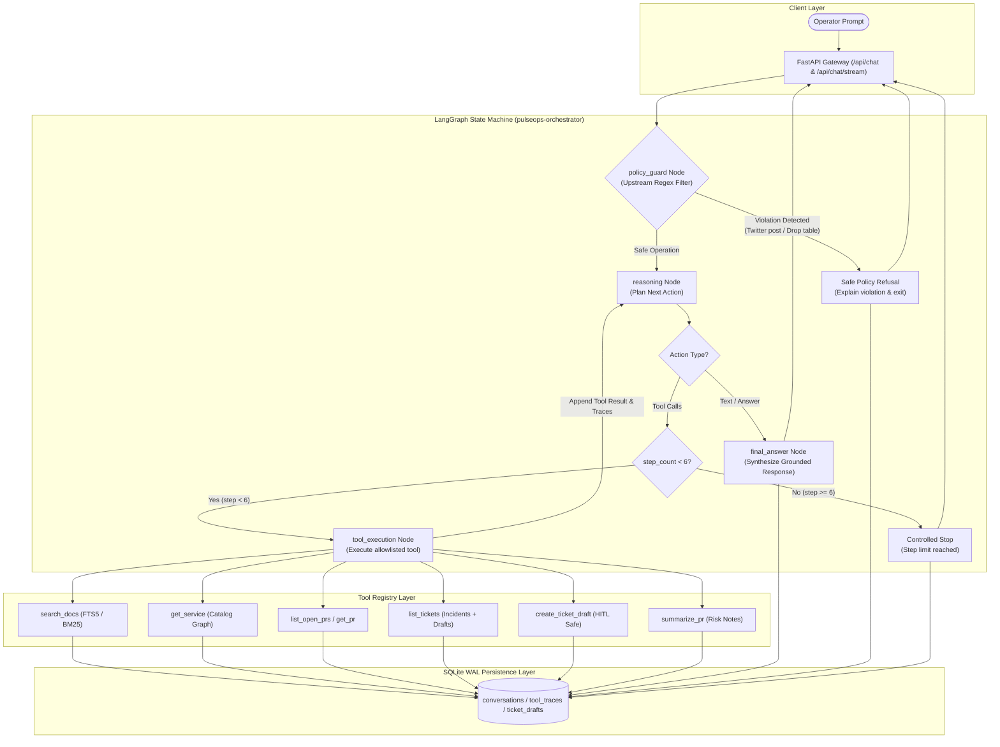

# PulseOps Agent: LangGraph State Machine Architecture (AGENT_GRAPH.md)

## 1. Overview & Control Flow

PulseOps orchestrates multi-step operational triage through an explicit **LangGraph `StateGraph`** state machine. Unlike fragile unbounded while-loops, the LangGraph graph enforces:
* Explicit state transitions with strong typing (`AgentState`).
* Deterministic upstream security and policy gating (`policy_guard`).
* Bounded recursion depth (`max_tool_rounds = 6`) to prevent runaway API spend or infinite tool execution loops.
* Full telemetry logging on every step (`repo.record_tool_trace`).

---

## 2. Mermaid State Graph



---

## 3. Node Specifications & Responsibilities

| Node Name | Handler Function | State Input / Output | Operational Responsibility |
| :--- | :--- | :--- | :--- |
| **`policy_guard`** | `_policy_guard_node` | Reads latest `user` message; sets `refusal_triggered` & refusal text if unsafe. | Inspects prompt against deterministic regex filters for public broadcast (Twitter/X) or destructive DB commands. Short-circuits immediately with zero LLM spend. |
| **`reasoning`** | `_reasoning_node` | Reads message history + tool schemas; returns tool call(s) or final answer. | Calls LLM provider (`OpenAILLMProvider` or `MockLLMProvider`). Enforces ReAct reasoning pattern over retrieved operational data. |
| **`tool_execution`** | `_tool_execution_node`| Consumes `pending_tool_calls`; increments `step_count`; appends `tool` messages. | Executes registered tools via `dispatch_tool`. Validates arguments via Pydantic v2. Measures duration and writes OpenTelemetry-style trace to SQLite. |

---

## 4. Conditional Edge Routing Logic

### 1. `_route_after_guard(state)`
- If `state["refusal_triggered"] == True`: Routes to `END`.
- Else: Routes to `"reasoning"`.

### 2. `_route_after_reasoning(state)`
- If `state["final_answer"] is not None`: Routes to `END`.
- If `state["pending_tool_calls"]` has items and `state["step_count"] < 6`: Routes to `"tool_execution"`.
- If `state["step_count"] >= 6`: Sets controlled stop explanation and routes to `END`.

---

## 5. Tool Trajectory Example: Multi-Tool Chain (`eval-chain-01`)

```text
Step 0 (policy_guard): Prompt is safe ("Find who owns checkout-api and create a P3 ticket draft for missing runbook section").
Step 1 (reasoning): Model detects dependency. Emits tool call: get_service(service_name_or_id="checkout-api").
Step 2 (tool_execution): get_service returns team "payments", on-call "@payments-oncall". Latency: 0.32ms.
Step 3 (reasoning): Model inspects retrieved owner team. Emits tool call: create_ticket_draft(title="Missing runbook...", priority="P3", team="payments").
Step 4 (tool_execution): create_ticket_draft creates TICK-DRAFT-XXXX with status DRAFT_PENDING_APPROVAL. Latency: 6.91ms.
Step 5 (reasoning): Model produces grounded final answer confirming ticket creation and ownership. Routes to END.
Total Execution: 2 tool rounds, ~47ms total turn latency.
```
